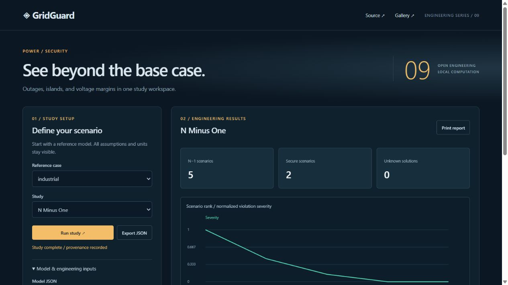

# GridGuard

Transparent N−1 contingency screening and voltage-stability studies for balanced power networks.



## Run

```powershell
python -m pip install -e .
gridguard serve --port 8773
gridguard study example:industrial
python -m unittest discover -q
```

Open http://127.0.0.1:8773. The service binds only to loopback; no frontend build or cloud execution is required. Python 3.11–3.13. Export complete JSON with original inputs, options and SHA-256 fingerprint, or print the current report.

## Engineering capabilities

Line/transformer branch and generator outages; AC or DC island analysis; explicit reference promotion; unsupplied load; voltage and thermal violation ranking; generator real-power adequacy and aggregate reactive reserve; analytic PTDF and bridge-aware LODF; DC outage screening; P–V and reactive-injection Q–V sweeps; pseudo-arclength continuation; corrective load reduction and generator redispatch comparisons.

## Scope and limits

Balanced positive-sequence static studies; no transient stability, cascading protection or frequency assessment. An island is statically supplied only with a valid reference; promotion of a reference-capable generator is an explicit assumption, not automatic proof that a real island can form. Nonconverged scenarios remain unknown. Real-power adequacy is unknown when Pmax is absent. Reactive output is unknown in DC mode. PTDF/LODF are single-connected-island lossless DC incremental factors with fixed taps and shifts; bridge outage columns are null. P–V/Q–V scans are sampled solves and a failed solve does not prove collapse. Continuation keeps PV types fixed and disables Q-limit switching. Corrective actions are enumerated evaluations, not an optimizer or redispatch guarantee.

## Validation

**228 passing tests**, including **200 complete analytical/reference cases** across twenty engineering families. Every case combines an input fixture, independent expected values, engineering derivation and executable regression in one reviewable commit. Further tests cover HTTP, CLI, boundary handling and input immutability. All three AC methods also match the external PYPOWER nine-bus reference. GitHub CI tests Python 3.11, 3.12 and 3.13 on Ubuntu. Passing tests establish the documented software checks, not installation certification.

Read [engineering conventions](docs/engineering.md), [API and interchange](docs/api.md), [validation](docs/validation.md), and [the ten-project gallery](https://victorodoyo.github.io/power-systems-gallery/). MIT license.
